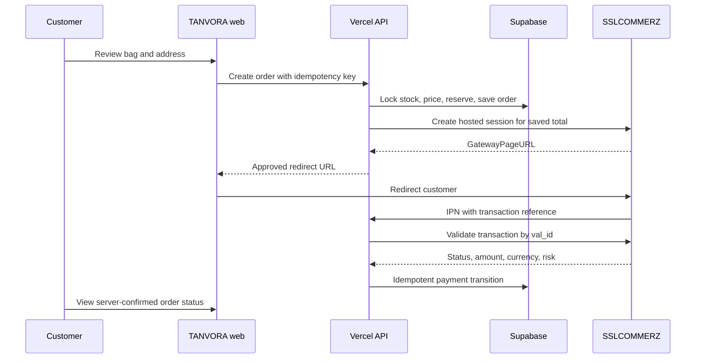

# TANVORA payment system design

Status: design for review, 12 October 2026. No payment acceptance is enabled by this document.

## Decision

Use **SSLCOMMERZ Hosted Checkout** for prepaid orders, with the **bKash channel enabled in the merchant account if offered under the signed agreement**. Keep **cash on delivery (COD)** as a separate method for eligible Dhaka addresses. This gives one hosted redirect and one verification path for bKash and any other approved channels. A direct bKash PGW adapter can be added later without changing order records if a direct merchant agreement and current API credentials are supplied.

The merchant must confirm gateway fees, settlement, refund process, enabled channels, and production onboarding. Do not display an unapproved channel or assume a published tariff. SSLCOMMERZ's public v4 guide is dated 2019; reconcile request fields and callback rules with the merchant's current integration pack before production.

## Customer experience

1. Product page: select an available colour and quantity. Price is shown in BDT. The primary action becomes **Add to bag** only for verified, published products with real stock; sample products remain preview only.
2. Bag: show item name, colour, quantity, unit price, subtotal, Dhaka delivery charge, and total. Recheck stock and prices on the server at checkout.
3. Checkout: collect name, Bangladeshi phone number, email, Dhaka delivery address, area, and optional delivery note. Show delivery time, return policy, and the exact total before the customer confirms.
4. Payment choice: **Pay online securely** (hosted SSLCOMMERZ page, including bKash when enabled) or **Cash on delivery** (only when business rules allow it). Do not collect a bKash PIN, OTP, or card details on TANVORA pages.
5. Online payment: create a server-side order and payment attempt, then redirect to the gateway's returned `GatewayPageURL`. The return page says **Checking payment** until the server has validated the transaction; a successful browser redirect alone never marks an order paid.
6. Confirmation: show order reference, items, total, method, and verified status. On failure/cancellation, preserve the bag and offer a new attempt using a new transaction ID. On COD, say **Order received, awaiting confirmation**, not “Paid.”

Accessible form errors appear next to fields and in an announced summary. The payment method is a radio group. A second click on Place order reuses the same checkout idempotency key. The design must work on a narrow mobile screen and support keyboard navigation.

## System boundary

The customer return and IPN may arrive in either order or more than once. Both call the same verification routine. If a callback is missing, a reconciliation job checks pending attempts through the gateway's transaction status API or merchant records. Never infer payment from a client-side parameter.

## Data model (dedicated TANVORA Supabase project)

| Record | Key fields and constraints |
| --- | --- |
| `orders` | UUID, public short reference, customer/contact/shipping snapshot, subtotal/delivery/total in **integer paisa**, currency `BDT`, method, order status, idempotency key, timestamps. Unique reference and idempotency key. |
| `order_items` | Order and variant IDs, SKU/name/colour snapshot, unit price in paisa, quantity, line total. Never recalculate a historical receipt from mutable catalogue values. |
| `payment_attempts` | Order ID, provider `sslcommerz`, unique merchant `tran_id` (maximum 30 characters per public guide), gateway session ID, `val_id`, gateway bank transaction ID, expected amount/currency, status, risk flag, timestamps. Unique `tran_id`; one active attempt per order. |
| `payment_events` | Attempt ID, source (`ipn`, `return`, `reconcile`), gateway reference, result, received time, minimal redacted diagnostic data. Unique provider event/validation reference when available. No PIN, OTP, card number, gateway password, or full raw payload. |
| `stock_reservations` | Variant ID, order ID, quantity, expiry, state. Atomic reserve/release/consume transactions so two buyers cannot purchase the last item. |

All order and payment tables have RLS enabled and no anonymous direct read/write grants. Browser requests go through narrowly scoped server endpoints. The Vercel API uses a Supabase **secret key only on the server**. Guest status lookups require a short-lived, opaque order access token stored as a hash, or verified phone/email ownership; an order ID alone is not authorization. Retain personal data only under an approved privacy and retention policy.

## Server API

| Endpoint | Purpose | Trust rule |
| --- | --- | --- |
| `POST /api/checkout/orders` | Validate address, bag, stock, delivery eligibility, current prices; atomically reserve stock and create COD or pending prepaid order. | Ignore all client-submitted price/total and publication/availability flags. Rate limit; idempotency key scoped to the shopper/session. |
| `POST /api/checkout/payments` | Initiate one SSLCOMMERZ session for the saved pending order and return an approved gateway redirect URL. | Server-held Store ID/password; fixed sandbox/live host; saved amount and unique `tran_id`. |
| `POST /api/checkout/sslcommerz/ipn` | Accept a gateway notification and verify `val_id` with the Order Validation API. | No state change based solely on posted status; compare validated `tran_id`, amount, currency, gateway store, and risk to the saved attempt. |
| `POST /api/checkout/sslcommerz/return/{success,fail,cancel}` | Process gateway browser return, perform the same verification where a `val_id` exists, then redirect to a status page. | Never treat the URL path as proof of payment. Missing/uncertain verification stays pending. |
| `GET /api/checkout/orders/:reference` | Return a minimal order status and receipt view. | Require the order access token or verified customer identity; `Cache-Control: no-store`. |

Server-side initiation supplies `success_url`, `fail_url`, `cancel_url`, and `ipn_url` on the **same public HTTPS TANVORA API origin**. Use the gateway's `GatewayPageURL`; allow only expected HTTPS gateway hosts to prevent an unexpected redirect. SSLCOMMERZ IPN uses POST and the merchant server must call its Order Validation API. A validated status of `VALID`/`VALIDATED` is eligible for paid status only when transaction ID, exact BDT amount, currency, and saved order match. Hold `risk_level=1` for manual review and do not dispatch. A gateway or database outage leaves status pending for retry/reconciliation, without starting a second charge automatically.

## State rules

| Method | Initial | Verified outcome | Fulfilment gate |
| --- | --- | --- | --- |
| Online | `pending_payment` | `paid`, `payment_failed`, `payment_cancelled`, or `payment_review` | Only `paid` with safe risk result can proceed. |
| COD | `pending_confirmation` | `confirmed`, `rejected`, or `cancelled` | Manual verification and stock reservation before dispatch. |

The payment attempt has its own `initiated → pending → verified_paid / failed / cancelled / review` state. Paid status is monotonic: a late failed callback cannot reverse a paid attempt. Refunds are separate records and operational actions, not a rewrite of the original payment. Reservation expiry may release unpaid stock, but late successful payment must enter manual review/refund handling rather than silently create an oversold order.

## Deployment and release gates

- Create a **separate TANVORA Vercel project** rooted at `tanvora-app/`; the current repository Vercel deployment serves the portfolio root and does not expose TANVORA APIs. GitHub Pages is static and cannot process checkout or callbacks.
- Create a **dedicated TANVORA Supabase project** and apply reviewed migrations there only. Test RLS and server permissions before data is entered. Keep the catalogue public read policy, order/payment private policy, and server key distinct.
- Store sandbox and live gateway credentials in Vercel server-side environment variables for their respective environments. Set a checkout feature flag **off** until real products, price/stock, delivery charges, policies, merchant contract, and live gateway credentials are confirmed.
- Sandbox test: successful bKash (if enabled) and card payments, cancelled/failed/expired payments, duplicate and out-of-order IPN, wrong amount/currency/transaction, risky response, concurrent last-item orders, return without IPN, IPN without return, gateway timeout, retry, reservation expiry, and COD confirmation/cancellation.
- Verify real low-value transactions and refund/reconciliation with the merchant before enabling production checkout. Confirm gateway fees, settlement timing, channel availability, receipt wording, customer support contact, and delivery/return terms.

## References

- SSLCOMMERZ v4 hosted checkout, IPN, validation, sandbox: https://developer.sslcommerz.com/doc/v4/
- SSLCOMMERZ sandbox signup: https://developer.sslcommerz.com/registration/
- bKash online business/merchant products: https://www.bkash.com/en/business
- Supabase API keys and server-only secret keys: https://supabase.com/docs/guides/getting-started/api-keys
- Vercel Functions for Vite: https://vercel.com/docs/frameworks/frontend/vite

## Open business inputs

1. Is there an approved SSLCOMMERZ merchant account, and is its bKash channel enabled? If instead there is a direct bKash PGW merchant agreement, obtain its current official integration pack and sandbox access.
2. What are the first real SKUs, variant stock levels, approved BDT prices, and product photographs?
3. What Dhaka areas are served, what are the delivery fee and estimated time, and which orders qualify for COD?
4. What are the approved returns/refunds policy, support contact, and privacy/retention wording?
